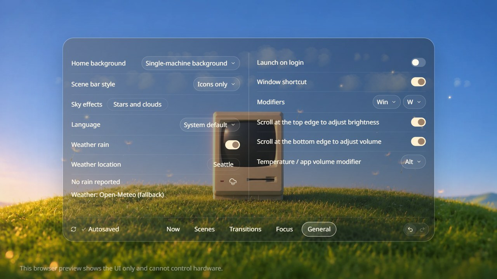
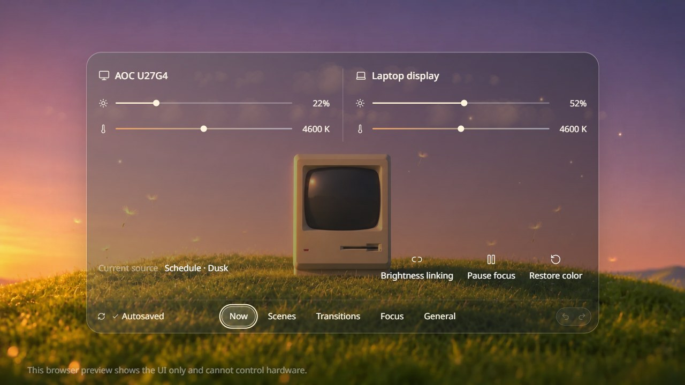
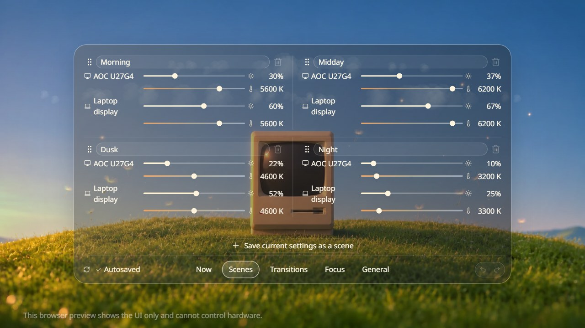
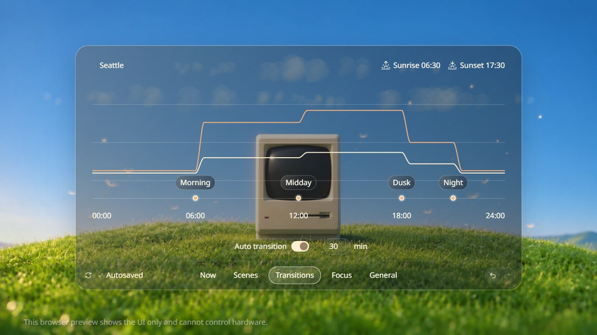
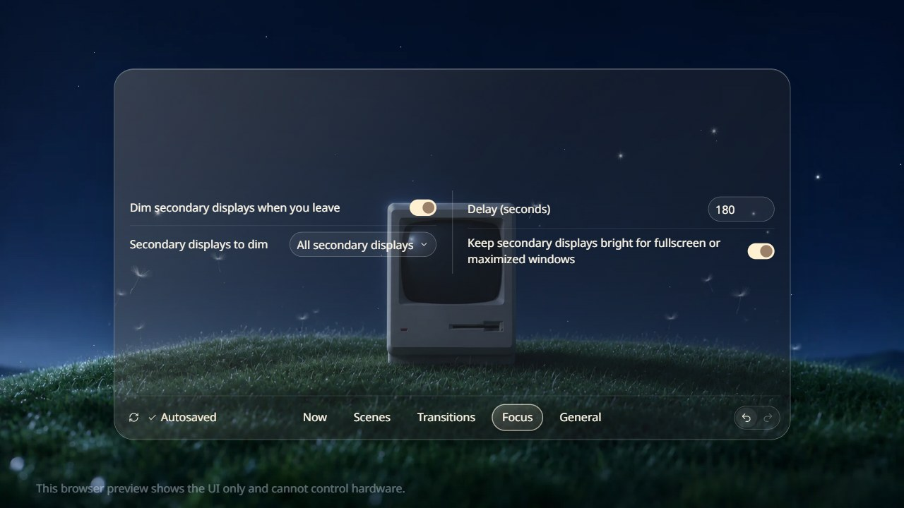
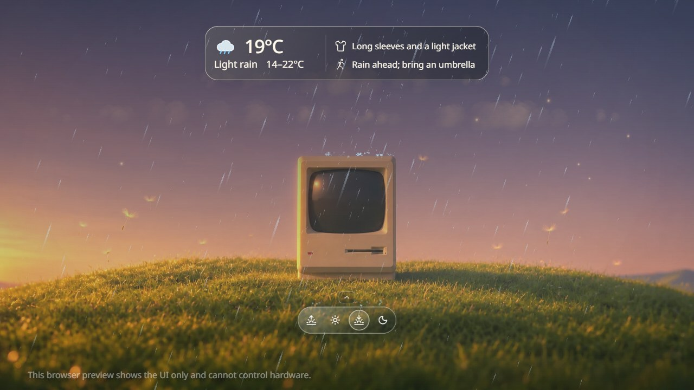
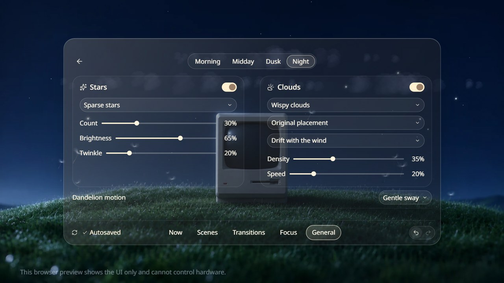

# MyScreen — Screen Controls for Windows

[简体中文](README.md) · English

Adjust your displays on Windows. Press `Win + W` to open the panel, or use the mouse wheel at the edge of your screen without opening it.

**Lightweight tray app: about 19 MB of memory.** This is from one Task Manager reading; actual usage varies. Closing the panel frees its interface while edge scrolling, scheduled transitions, and Focus keep working.

<h2 align="center">Product demo</h2>

https://github.com/user-attachments/assets/321a01ba-bdf3-41b0-b84b-7249cf1c68eb

1 min 37 sec · English narration · [Video credits](docs/media/VIDEO-CREDITS.md)

This video was recorded before the rename and uses the former name, Monitors Focus.

The screenshots show the app with sample display and weather data.

<h2 align="center">Adjust volume and brightness with the mouse wheel</h2>

Enable edge scrolling under **General**. Scroll at the **top edge** to change that screen’s brightness, or at the **bottom edge** to change system volume. Hold **Alt** (the default modifier) to adjust color temperature at the top edge or the active app’s volume at the bottom, if that app supports separate volume control.

<h2 align="center">Adjust brightness and color temperature for each display</h2>

Under **Now**, adjust your laptop and external display separately. To make both brighter or dimmer together, turn on **Brightness linking** and move either brightness slider.

<h2 align="center">Save and switch between display presets</h2>

Use a brighter setup for daytime work and a warmer one for nighttime reading. Edit each display’s values in **Scenes**, or save your current setup as a new scene. From the home screen, click an icon or use `←` and `→` to switch.

<h2 align="center">Schedule changes to brightness and color temperature</h2>

In **Transitions**, drag a point to set when a scene starts, or schedule it around sunrise or sunset. Set a duration for brightness and color temperature to change gradually instead of all at once.

<h2 align="center">Black out a second display when you leave it</h2>

In **Focus**, choose a secondary display and set a delay. A black overlay covers that screen when the pointer leaves; moving it back restores the view without changing the backlight. You can also keep the display visible while watching a full-screen video.

<h2 align="center">See current weather and rain on the home screen</h2>

The home screen can show scenes as icons only. Press `↓` to check the current temperature and get advice before heading out. If weather effects are enabled, rain appears on the home screen when it’s raining in your selected location.

<h2 align="center">Customize the stars and clouds in each scene</h2>

In **General → Stars and clouds**, adjust how bright the stars are and how much they twinkle, or change the density and speed of the clouds. Each scene remembers its own settings, and these effects only change the home screen.

<h2 align="center">Install and launch</h2>

- Requires Windows 10/11 x64 and Microsoft Edge WebView2 Runtime. External-display brightness control requires DDC/CI support and must be enabled on the monitor. Color temperature control requires a compatible SDR display.
- Build the current Go version from source: run `./scripts/build.ps1 -Check -Package`, then launch the generated `MonitorsFocus.Go.exe`. You can enable launch on sign-in under **General**. Older GitHub releases do not reflect the current Go version.
- [Product guide (Chinese)](docs/PRODUCT.md) · [Build and update notes (Chinese)](docs/DEVELOPMENT.md) · [Project status (Chinese)](docs/STATUS.md) · [License](LICENSE)
