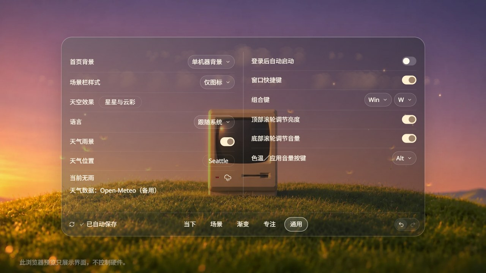
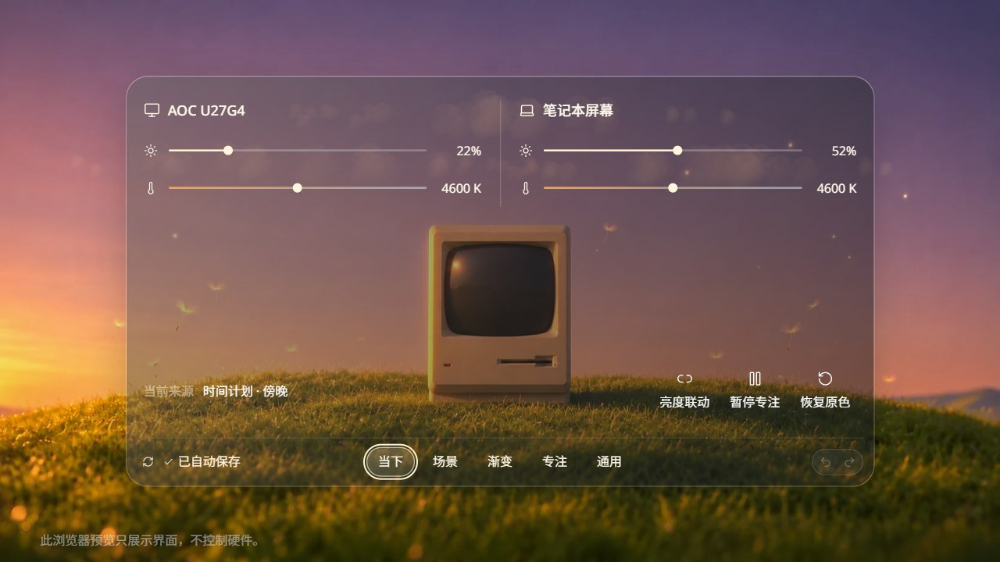
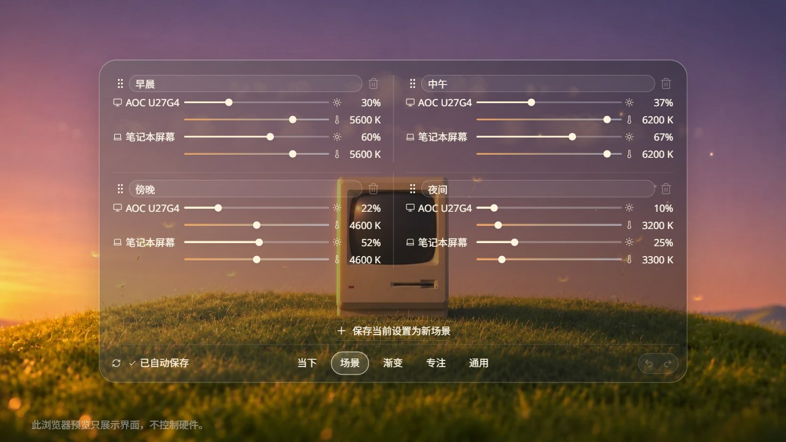
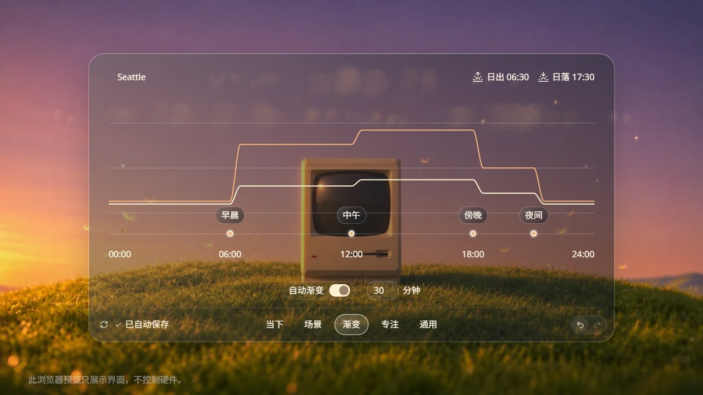
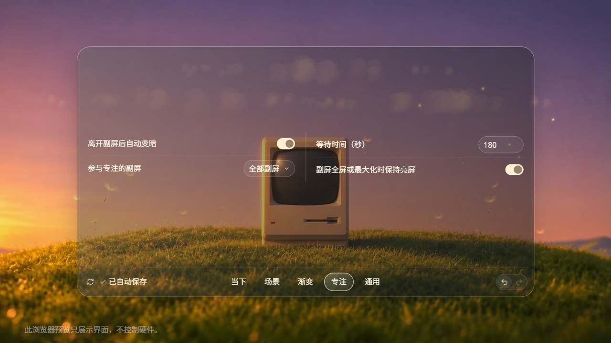
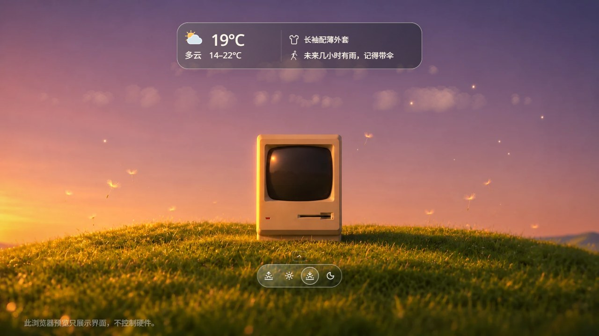
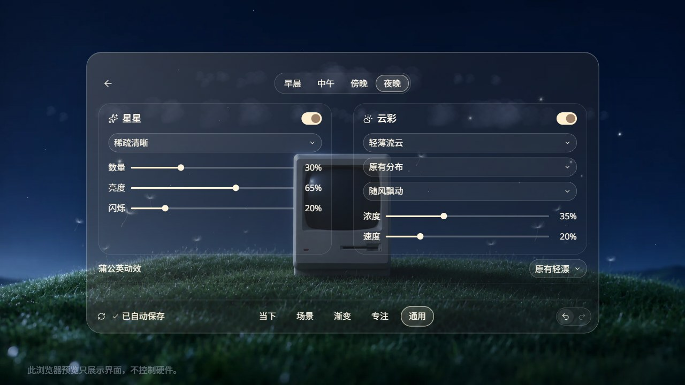

# Monitors Focus

在 Windows 上，让每块屏幕都舒服一点。用 `Win + W` 呼出面板，也可以不打开它，直接在屏幕边缘滚动鼠标。

**轻量后台：常驻进程约 19 MB。** 这是本机任务管理器的一次实测，实际占用因环境而异。关掉面板会释放界面，边缘滚轮、定时渐变和专注仍可继续工作。

以下为软件界面截图，显示器和天气数据用于演示。

## 屏幕边缘滚一滚，不用找设置

在「通用」开启边缘滚轮。鼠标移到屏幕**顶部**滚动，调这块屏的亮度；移到**底部**滚动，调系统音量。按住默认的 **Alt** 再滚，顶部调屏幕冷暖，底部只调正在出声的前台应用（如果它支持单独调音量）。

## 每块屏分别调，也可以一起调

在「当下」为笔记本和外接屏分别调亮度、色温。想让屏幕一起变亮或变暗，打开「亮度联动」，再拖其中一个亮度滑条就行。

## 把常用搭配存成场景

白天办公用偏亮的设置，晚上阅读换成柔和的暖色。在「场景」里为每块屏保存数值，也可以把当前搭配存成新场景。回到首页，点图标或按 `←` / `→` 就能切换。

## 到点自动换，不用每天手调

在「渐变」里拖动时间点，决定什么时候切到哪个场景，也能按日出、日落安排。设好渐变时长，亮度和色温就会慢慢过渡，不用一下子切换。

## 不用副屏时，让它安静下来

在「专注」里选好副屏和等待时间。鼠标离开后，副屏会盖上一层暗色遮罩；移回去就恢复，不改显示器背光。看全屏视频时，也可以让副屏保持亮着。

## 打开，是一个安静的小家

首页的场景栏可以设成只显示一排图标。按 `↓` 看当前气温和出门建议；启用天气雨景后，只有当地正在下雨，画面才会跟着下雨。

在「通用 → 星星与云彩」，可以分别给四个场景调星星的亮度、闪烁，或云彩的浓淡、飘动速度。这些只改变首页画面。

## 开始使用

- 需要 Windows 10/11 x64 和 Microsoft Edge WebView2 Runtime。外接屏的亮度调节需要显示器支持并启用 DDC/CI；色温调节适用于兼容的 SDR 屏幕。
- 当前 Go 版从源码构建。执行 `./scripts/build.ps1 -Check -Package`，然后运行生成的 `MonitorsFocus.Go.exe`。首次打开后，可在「通用」开启登录自启。GitHub 上的历史发布包不代表当前版本。
- [产品说明](docs/PRODUCT.md) · [开发与更新](docs/DEVELOPMENT.md) · [验证状态](docs/STATUS.md) · [许可证](LICENSE)
